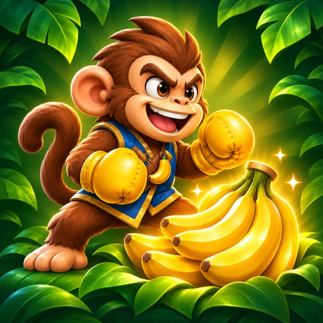
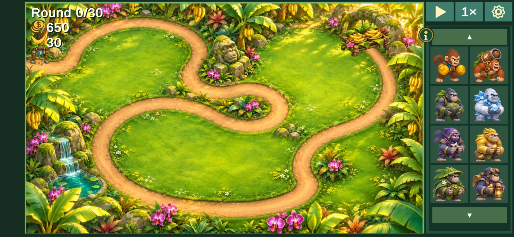
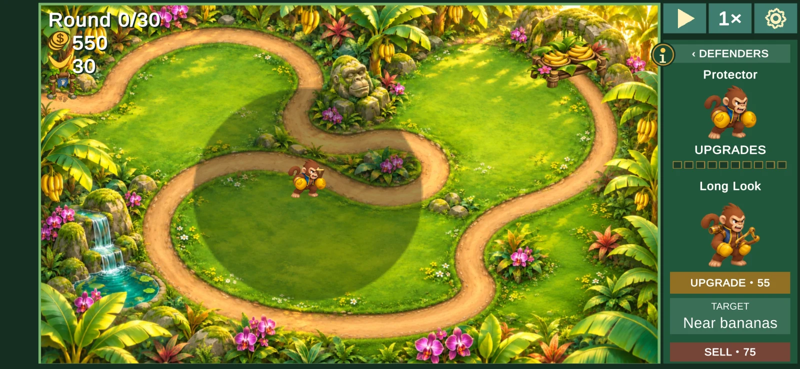

  
In development<h2>Big jungle. Precious bananas.</h2>
The thieves know the way to the stash. Give them a welcome they won't forget. Place your Rillas beside the trail, grow their powers and catch the escaping crew before your bananas leave the jungle.
<a class="button" href="#the-first-adventure">Explore the adventure</a>

  

<h2 id="the-first-adventure">Welcome to Banana Grove Commons</h2>

The first Adventure takes place on one winding jungle trail, with a stone arch
cache to protect. Start with 30 bananas and build a team to face **30 rounds**
of thieves. Quick Snakes, flying Parrots and King Raccoon's crew will give you
new reasons to rethink your defenses.

<figure class="game-screenshot">
  
  <figcaption>Actual Android development screenshot: getting ready for the first of 30 rounds. Tap the image for a closer look. The game is still being refined.</figcaption>
</figure>

## Place a team. Grow its powers.

Drag a defender onto clear ground, or tap a portrait and then a spot beside the
trail. Placement is freeform: cover a bend, guard the cache or catch thieves on
their return trip. Captures earn Jungle Coins for more defenders and upgrades.

- **Protector** gets your defense started, while **Coconut Cannon** and **Rock**
  bring heavier attacks.
- **Ice** and **Vine** help control the crowd. **Lantern** and other support
  Rillas give you more ways to build a team.
- **Ten cumulative upgrades per defender** add distinct appearances and powers
  while keeping the abilities you've already bought.
- **Powers fire automatically.** Plan your placement and purchases; your team
  handles its attacks and timed abilities.
- **Inspect before buying.** The information button explains defenders, thieves
  and the next upgrade, with character previews.

Adventure offers nineteen ordinary defenders. The special Darrilla character
is available to explore in Workshop, rather than a purchase goal in Commons.

<figure class="game-screenshot">
  
  <figcaption>Actual development screenshot: select a placed Rilla to see its reach, next upgrade, targeting choice and sale value. The icon at the top of this page is promotional artwork.</figcaption>
</figure>

## A stolen banana isn't gone yet

Loaded thieves retrace the same trail toward the exit. Capture one before it
escapes and its bananas return to the cache. Your team captures thieves for the
jail; defending the grove is about stopping the getaway.

Keep bananas safe through the final round to earn a medal. Replay to try another
team or improve your best result. The current Adventure focuses on this one
level, with a finale featuring two Kings.

## Experiment, then take a break

**Workshop** is a separate sandbox for trying the twenty-character roster and
its upgrades with test resources. Workshop experiments do not spend Adventure
coins or replace its saved run.

Play in landscape, pause when you need to, choose a speed from 1× to 4×, or turn
on Calm motion. Sound can be switched off separately. Optional instructions can
be skipped and reopened, and Adventure has its own saved resume on your device.
The current game works offline, with no ads, purchases or player account.

## Follow BananaRilla

BananaRilla: Jungle Defense is in development, with local Android playtesting.
There is no public download or store release date announced here yet. We'll add
verified download and testing links when they're available.

Questions or interested in future testing?
[Email Darrilla](mailto:darrilla@gmail.com?subject=BananaRilla%20Jungle%20Defense).

---

[Support and how to play](/bananarilla/support/) ·
[Privacy policy](/bananarilla/privacy/) · [About Darrilla Software](/about/)
